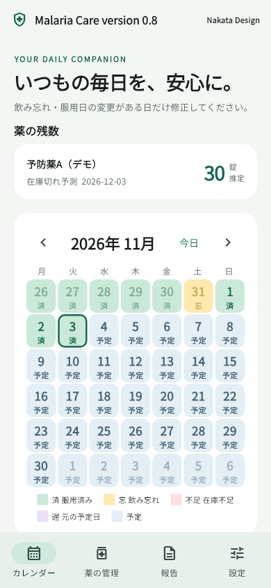
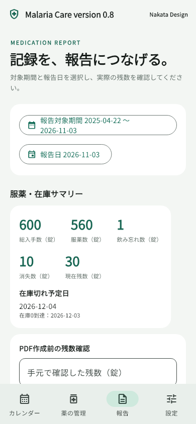
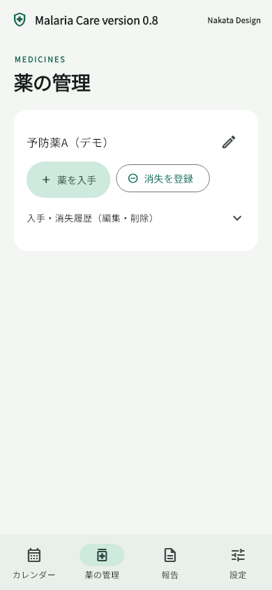

# Malaria Care version 0.8

マラリア予防薬の服用記録・残数・報告書を管理するアプリです。

## アプリを試したい方へ

**Android版**は、このリポジトリの **Releases → v0.8 → malaria-care-v0.8.apk** から取得してください。APKはCode内ではなく、公開者がReleasesの添付ファイルに配置します。初回は端末にインストールの許可を求められる場合があります。更新する場合は、現在のアプリをアンインストールせずにAPKを開いてください。

**iPhone版**のソースも含みますが、インストール用アプリはまだ配布していません。GitHubのZIPやAndroid用APKはiPhoneにインストールできません。iPhoneで他の方に試してもらうには、Apple Developer Programへの登録と、TestFlight等での署名済みアプリ配布が必要です。準備状況と手順は[こちら](docs/IOS.md)をご覧ください。

このアプリは本番リリース前の利用者検証用です。処方・服用頻度・遅延時の対応は医療担当者の指示に従って設定してください。

## できること

- カレンダーで服用済み・飲み忘れ・遅延服用を管理
- 薬の入手・消失と残数・在庫切れ予測を記録
- 服用リマインダーと翌日の服用確認を別々に設定
- 報告対象期間と報告日を選び、残数確認後にPDFを作成
- PDFの保存・共有・メール添付
- バックアップの保存・復元

新規利用時の通知は両方OFFです。ONにするとOSの通知権限を確認します。データは端末内に保存し、開発者へ自動送信する機能はありません。詳しくは[データの取り扱い](docs/PRIVACY.md)を参照してください。

## 画面例

以下は表示確認用の架空データです。新規インストールでは空の状態から始まります。

  

## 開発者向け

Flutter **3.47.9** / Dart **3.13.7** を使用しています。依存バージョンは`pubspec.lock`に固定し、通知ライブラリのローカル修正版`vendor/fln`を同梱しています。フォルダーごと取得してください。

```sh
flutter pub get --enforce-lockfile
dart analyze --fatal-infos lib
dart analyze --fatal-infos test
flutter test
```

AndroidのアプリIDは既存利用者の更新互換性のため維持しています。別のPCで作成したAPKは署名が異なるため、既存配布APKへの上書き更新に使えない場合があります。署名鍵をGitHubへ置かないでください。

## 自動確認とiPhone向けビルド

- **Check source and tests**：mainへの更新・プルリクエストでWindows上の解析・テストを実行します。
- **Build iOS simulator app**：Actionsから手動で起動し、GitHubのMac上でシミュレーター向けアプリをビルドします。
- **Check iOS device build (unsigned)**：Actionsから手動で起動し、iPhone向けコードがビルドできるか確認します。

後者2つは署名なしの確認用で、ダウンロードしてもiPhoneにはインストールできません。Appleへの提出や公開は自動では行いません。GitHub上でのワークフロー実行とiOSの実機確認は未実施です。

## ドキュメント・サンプル

- [GitHubでの配布手順](docs/GITHUB_RELEASE.md)
- [iPhone版の準備・ビルド・配布](docs/IOS.md)
- [構成と検証範囲](docs/DEVELOPMENT.md)
- [0.8版の変更内容](CHANGELOG.md)
- [毎日服用する架空サンプルPDF](sample-report.pdf)
- [週1回メフロキンの架空サンプルPDF](sample-report-mefloquine-weekly.pdf)
- [第三者ソフトウェアの表示](THIRD_PARTY_NOTICES.md)

## 利用条件

本版は[独自の利用条件](LICENSE.md)に基づき無償で利用できます。**改変・再販売は禁止**です。未改変・無償でもAPK等の第三者による再配布は認めず、正規配布元のリンク共有のみ認めます。通常のアプリ設定・入力データ・PDFの編集や共有は、この禁止と区別しています。

将来新しく提供する版・機能・サービスでは、有料化その他の条件変更を行う場合があります。変更はその提供時に明示し、旧版の利用へ遡って料金を請求する定めにはしていません。

第三者ライブラリ・フォントには各ライセンスが適用されます。公開リポジトリの閲覧・フォークについてはGitHub規約に従います。詳しくは[利用条件の方針](docs/LICENSE_GUIDE.md)を確認してください。
